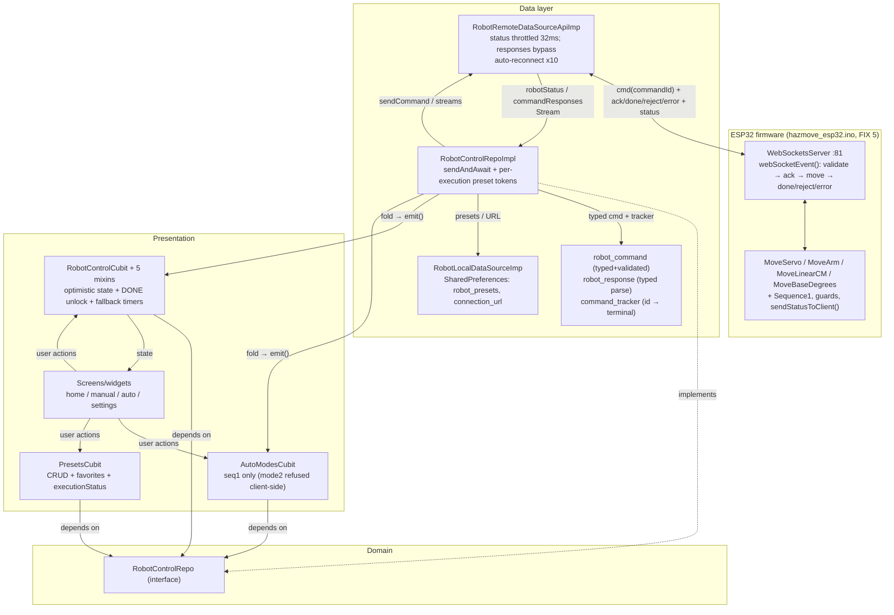

# HazMove Robot — Reference Document

> Owner: Marwan (Flutter app; team project — hardware/firmware by teammates).
> Last verified against repo state: Oct 2026, post-refactor (clean tree — see §9).
> Convention: **Verified** = checked in a file listed in parentheses. **Inferred** = best reading, with justification. Anything else is `TODO(Marwan)`.
> Wire contract: `docs/protocol.md` is authoritative (Flutter schema == protocol.md == ESP32 parser).

---

## 1. 30-second pitch

**English:** HazMove is a Flutter app that drives a 5-servo robotic arm on a linear rail + rotating base over Wi-Fi WebSocket, paired with ESP32 firmware. I (Marwan) owned the whole mobile app: Clean-Architecture Flutter client, real-time control with safety interlocks, and an isometric 3D arm simulator. Strongest technical points: (1) typed command protocol — every motion carries a `commandId` correlated `command → ACK → DONE/REJECT/ERROR` with the firmware (`lib/modules/robot_control/data/protocol/` + `docs/protocol.md` — Verified); (2) dual-sided safety — DONE-based completion with defensive timeout fallbacks in the app matched by range-reject guards on the ESP32 (`hazmove_esp32/hazmove_esp32.ino` FIX 5 — Verified); (3) 98-test suite + CI enforcing `analyze` + `test` + `build apk --debug` (Verified).

**العربية:** هازموف تطبيق فلاتر يتحكّم بذراع روبوتية (5 محركات سيرفو على سكة خطية وقاعدة دوّارة) عبر WebSocket مع متحكّم ESP32. أنا (مروان) بنيت تطبيق الموبايل كاملاً: عميل فلاتر بمعمارية نظيفة، تحكّم لحظي مع أقفال أمان، ومحاكٍ ثلاثي الأبعاد للذراع. أقوى النقاط تقنياً: (1) بروتوكول أوامر مكتوب بأنواع مع `commandId` وربط `ACK → DONE/REJECT/ERROR` مع المتحكّم؛ (2) أمان على الطرفين — إكمال عبر `DONE` مع مهلات احتياطية في التطبيق، يقابله رفض خارج الحدود في الـESP32؛ (3) حزمة 98 اختباراً مع CI.

**2-minute extended version:**

- **Problem:** The arm + rail + base rig had no mobile interface; control was via physical buttons on the ESP32 box (`BTN_SEQ1/SEQ2`, `PAUSE_SWITCH`, `BTN_STOP` in `hazmove_esp32/hazmove_esp32.ino` — Verified) plus hardcoded `Sequence1()`/`Sequence2()`.
- **What the app does:** Connects to `ws://192.168.4.1:81` (ESP32 soft-AP default, `lib/core/constants/app_constants.dart` + `.ino setup()` — Verified), sends typed JSON commands (`servo` / `linear` / `base` / `stop` / `pause` / `resume` / `mode`, each with `commandId`), awaits firmware `ack` → `done`/`reject`/`error`, renders live `status` broadcasts in a Cubit-driven UI with manual sliders, auto sequences (`seq1`; Mode 2 disabled by design — `docs/protocol.md` §5 — Verified), user presets stored in `SharedPreferences`, EN/AR localization, and dark/light themes.
- **What the Oct 2026 refactor changed (Verified via `git log`, 16 refactor commits):** formal protocol spec, verified motion limits everywhere (rail 0–45 cm, base ±180°), ACK/DONE correlation both sides, typed protocol layer, deleted duplicated models, split the 498-line cubit into mixins, per-execution preset cancellation, real network check, 98 tests, CI, README rewrite, dependency cleanup, localized failures.
- **My contribution (Verified from file ownership of the entire `lib/` tree + git log):** all Flutter layers — `lib/core` (DI, routing, errors, theme), `lib/modules/robot_control` (entities/protocol/models/mappers/repo + WS/local data sources), `lib/presentation/view/{root,home,manual,auto,settings}`, the `docs/protocol.md` contract, and the firmware response-protocol half (FIX 5 `ack`/`done`/`reject`/`error` in the `.ino` — Verified, but **not yet compiled**: no Arduino toolchain on this machine).
- **Out of scope for me:** ESP32 wiring, servo/stepper tuning, `Sequence1()` choreography (teammates' work — Inferred from `.ino` authorship comments and Marwan's answer).

---

## 2. Tech stack

| Package | Version (pubspec.yaml — Verified) | Purpose in this repo | Why (Inferred unless noted) |
|---|---|---|---|
| `flutter` (SDK) | `^3.11.5` constraint; measured `3.44.2` / Dart `3.12.2` (`flutter --version` — Verified); app `1.0.0+1` | UI framework | Team standard; constraints in `pubspec.yaml` (Verified) |
| `flutter_bloc` | `^8.1.6` | `Cubit` state mgmt (`RobotControlCubit`, `AutoModesCubit`, `PresetsCubit`, `ThemeCubit`) | Reactive streams fit WS push model (Inferred) |
| `hydrated_bloc` | `^9.1.3` | Persists `ThemeCubit` via `HydratedStorage` (`lib/main.dart`, `lib/core/style/theme_cubit.dart` — Verified) | Zero-backend theme persistence (Inferred) |
| `get_it` | `^7.7.0` | Service locator, wired in `lib/core/di/main_di.dart` (Verified) | Simple DI without codegen (Inferred) |
| `web_socket_channel` | `^3.0.3` | `WebSocketChannel.connect()` in `robot_control_remote_data_source_api_imp.dart` (Verified) | Single persistent low-latency channel to ESP32; sole transport — no HTTP/BLE (Verified by grep: `http` removed) |
| `fpdart` | `^1.1.0` | `Either<Failure, T>` across `RobotControlRepo` + impl (Verified) | Typed error channel without exceptions in signatures (Inferred) |
| `equatable` | `^2.0.5` | Value equality for states/entities/`Failure` (Verified) | Cheap `BlocBuilder` rebuild control (Inferred) |
| `shared_preferences` | `^2.3.2` | Presets JSON (`robot_presets`) + `connection_url` in `robot_control_local_data_source_imp.dart` (Verified) | No backend; presets are local-only (Inferred) |
| `easy_localization` | `^3.0.7` | EN/AR via `assets/translation/*.json` (+ `errors.*` keys), `locale_keys.g.dart` (Verified) | Bilingual requirement (Inferred) |
| `flutter_screenutil` | `^5.9.3` | `ScreenUtilInit(designSize: 360x690)` in `lib/presentation/view/root/app.dart` (Verified) | Phone-first responsive layout (Inferred) |
| `path_provider` | `^2.1.3` | `getApplicationDocumentsDirectory()` for Hydrated storage (`lib/main.dart` — Verified) | Required by `hydrated_bloc` (Inferred) |
| `flutter_native_splash` / `flutter_launcher_icons` | `^2.4.0` / `^0.14.4` | Splash (`#202125`) + launcher icon from `assets/icon.png` (Verified) | Polish (Inferred) |
| REMOVED Oct 2026 (Verified via `git show 12f7e43` + repo-wide grep) | `http`, `cupertino_icons`, `json_annotation`, `json_serializable`, `build_runner` | Nothing imported them; JSON is manual `fromJson`/`toJson`, no codegen | Smaller surface, faster resolve (Verified: `pub get` + analyze + tests re-run) |
| Firmware libs (ESP32, not pub) | `WebSocketsServer(:81)`, `ArduinoJson`, `ESP32Servo`, `AccelStepper` (`hazmove_esp32/hazmove_esp32.ino` — Verified) | WS server, JSON parse, servo PWM, stepper accel | Standard ESP32 stack (Inferred) |

---

## 3. Architecture

### 3.1 Annotated folder tree (Verified via directory reads + glob, post-refactor)

```text
lib/
├── main.dart                        # ensureInitialized → initDI → EasyLocalization → HydratedStorage → MyApp
├── core/
│   ├── constants/app_constants.dart # WS URL, limits (rail 0–45, base ±180), RobotCommands+Reasons, RobotModes, ServoIds
│   ├── di/main_di.dart              # GetIt: ThemeCubit, NetworkInfo, 2 data sources, repo, 3 cubits (lazy singletons)
│   ├── error/failure.dart           # Failure + FailureType (rejected/firmwareError/disconnected/cancelled added) + userMessage/messageKey
│   ├── network/network_info.dart     # Real local-interface check w/ injectable probe; advisory, WS authoritative
│   ├── routing/                     # app_router.dart (4 routes) + route_guard.dart (connection guard)
│   ├── style/                       # theme_cubit.dart, app_colors.dart, glass_container.dart, …
│   ├── services/localization/       # locale_keys.g.dart (incl. errors_* keys)
│   └── utils/ extensions/           # logger.dart, validators.dart (45 cm / ±180°), theme/screenutil extensions
├── modules/robot_control/
│   ├── domain/entities/             # robot_arm, servo, linear_rail, base_rotation, movement_preset (+step)
│   ├── domain/enums/robot_enums.dart# RobotMode{manual,auto,seq1,seq2}, RobotStatus{idle,moving,paused,error}
│   ├── domain/repo/robot_control_repo.dart  # Either-based interface (streams + futures + cancelPresetExecution)
│   ├── data/models/                 # THE single model set (extend entities; domain/models/ deleted Oct 2026)
│   ├── data/mappers/                # servo/robot_arm/linear_rail/base_rotation/preset mappers
│   ├── data/providers/              # remote DS impl (WS), local DS impl (SP), repo impl (sendAndAwait + tracker)
│   ├── data/protocol/               # command_id, robot_command (7 typed cmds), robot_response, command_tracker
│   ├── data/services/               # preset_cancellation_token.dart (per-execution tokens)
│   └── data/robot_control_{remote,local}_data_source.dart  # abstract contracts (+unthrottled commandResponses)
├── presentation/view/
│   ├── root/                        # app.dart (MultiBlocProvider) + cubit/robot_control_cubit.dart + cubit/mixins/×5
│   ├── home/                        # home_screen + 10 widgets (visualization, connection card w/ localized failures, nav, …)
│   ├── manual/                      # manual_control_screen + 6 widgets (servo/linear/base controls, …)
│   ├── auto/                        # auto_mode_screen + cubit/{auto_modes,presets}_cubit (+executionStatus) + utils + 11 widgets (Mode 2 = disabled tile)
│   └── settings/                    # settings_screen + 7 widgets (connection+s saved URL, 45 cm/±180° limits, theme/lang, safety…)
├── docs/protocol.md                 # AUTHORITATIVE wire contract (commands, limits, ack/done/reject/error)
├── CHANGELOG.md                     # architectural/protocol changelog
├── .github/workflows/ci.yml         # analyze + test + build apk --debug
hazmove_esp32/hazmove_esp32.ino      # ~810-line firmware: WS server, FIX 1–5, ack/done/reject/error, guards, sequences, loop()
assets/translation/{en,ar}.json      # localization strings (incl. errors.*)
test/                                # 98 tests: fakes + protocol/data/core/cubit/network/widget (no hardware)
```

> Historical note: the pre-Oct-2026 `README.md` described `lib/core/{usecases,…}` and `features/…` — that tree never matched the repo and the README has since been rewritten from this layout (commit `9a3d0d8` — Verified).

### 3.2 Responsibilities of each layer

| Layer | Files | Responsibility |
|---|---|---|
| Presentation (Cubits + widgets) | `lib/presentation/view/**` | Slim `RobotControlCubit` (coordination only) + 5 mixins: connection, safety, servo, linear rail, base. Optimistic updates (`update*Locally` during drag, send on release); DONE unlocks immediately; `isMoving` guards; `RouteGuard`; `CustomPainter` simulator |
| Domain (entities + repo contract + enums) | `lib/modules/robot_control/domain/**` | Pure-Dart business types; `RobotControlRepo` returns `Either<Failure,T>` / `Stream<Either<…>>`; no Flutter imports |
| Data (protocol + models + mappers + providers) | `lib/modules/robot_control/data/**` | Typed commands validated client-side then `sendAndAwait` (track `commandId` → terminal frame); `RobotResponse.fromJson` parses `ack/done/reject/error/status`; `CommandTracker` correlates; local DS persists presets/URL; remote DS owns the socket |
| Core | `lib/core/**` | DI, routing, `Failure` taxonomy + l10n keys, theme, constants (= protocol.md = firmware), validators, advisory `NetworkInfo` |
| Firmware | `hazmove_esp32/*.ino` | WS server on `:81`; per-client `ack` then blocking motion then `done`; `reject` on out-of-range/invalid/busy/missing/unknown (never silent when `commandId` present); `error` on `INTERRUPTED`; `seq2` → `SEQUENCE_NOT_IMPLEMENTED`; `sendStatusToClient()` broadcasts |

### 3.3 Data-flow diagram (Verified against the files named in §3.2)



Command path example (Verified): slider release → `ServoControlMixin.setServoAngle()` (optimistic `isMoving=true`) → `RobotControlRepoImpl` builds `ServoCommand{servo_id,end,speed,commandId}` → validate → `tracker.track(id)` → `sink.add(jsonEncode)` → `.ino` validates → `sendAck(num,id)` → `controlServoById()` → `sendDone(num,id)` → `tracker.resolve` → repo `Right` → mixin unlocks + `clearFailure` → rebuild. REJECT/ERROR/timeout → typed `Failure` → unlock + surfaced banner.

### 3.4 DI structure (Verified — `lib/core/di/main_di.dart`, `lib/main.dart`, `lib/presentation/view/root/app.dart`)

- `initDI()` registers **all lazy singletons**: `ThemeCubit`, `NetworkInfo`, 2 data sources, one shared `RobotControlRepoImpl` (now constructed with `networkInfo`), 3 cubits. `main()` awaits `initDI()` → `EasyLocalization.ensureInitialized()` → builds `HydratedStorage` → `runApp(EasyLocalization(…MyApp()))`.
- `MyApp` exposes `ThemeCubit`, `RobotControlCubit(..loadStatus())`, `AutoModesCubit`, `PresetsCubit(..loadPresets())` via `MultiBlocProvider` (`.value` with GetIt instances).
- No scopes/factories: cubits live for the app lifetime (Inferred trade-off — simple but streams never re-created).

### 3.5 Routing (Verified — `lib/core/routing/app_router.dart`, `route_guard.dart`)

Four named routes (`/`, `/manual`, `/auto`, `/settings`) via `onGenerateRoute`; unknown → `HomeScreen`. `RouteGuard.canNavigate(requireConnection:)` blocks manual/auto entry when `RobotControlCubit.state.connectionStatus != connected` with a red SnackBar. **Inferred:** guard is opt-in per call site — `TODO(Marwan)`: verify each `navigateTo` passes `requireConnection: true`.

### 3.6 Error-handling strategy (Verified — `lib/core/error/failure.dart`, repo impl, mixins, `connection_status_card.dart`)

- `Failure(message, type)` with `FailureType{…,rejected,firmwareError,disconnected,cancelled}` (added Oct 2026); `userMessage` gives SnackBar-safe text; `messageKey` maps fixed-text failures to `errors.*` l10n keys (EN/AR), dynamic detail (reject reasons, limit values) falls back to raw English — Verified in `failure.dart` + `validators_failure_test.dart`.
- Repo maps: `DoneResponse` → `Right`; `RejectResponse` → `rejected` (+ friendly per-reason text); `ErrorResponse` → `firmwareError`; no terminal frame → `timeout`; send throw → `fromException`. Client-side range violations fail fast without touching the socket (Verified in `robot_control_repo_test.dart`).
- Mixins `fold` into `state.failure`, unlock the axis, and `clearFailure` on success; defensive timers fire `timeout` failures only if still locked (never success). Connection card prefers `messageKey.tr()`.

---

## 4. Feature-to-code map

| Feature | Entry point | Key classes / files | Notes |
|---|---|---|---|
| Connect / disconnect (WS + auto-reconnect) | Settings → Connection section (saved-URL preload); `ConnectionControlMixin.connect(url)` | `connection_section.dart`, `cubit/mixins/connection_control_mixin.dart`, `robot_control_remote_data_source_api_imp.dart:41`, `AppConstants.defaultWebSocketUrl`, advisory `NetworkInfo` pre-check in `RepoImpl.connect` | Exp. backoff 2s×2ⁿ, max 10 tries; `_intentionalDisconnect` suppresses retry (Verified) |
| Manual servo control | `manual_control_screen.dart` → `servo_control_widget.dart` | `mixins/servo_control_mixin.dart` (guard + optimistic lock + speed-aware fallback 16–40 s), typed `ServoCommand` | Local-only update while dragging; DONE unlocks; repo ceiling 15 s |
| Linear rail control | `linear_rail_control_widget.dart` | `mixins/linear_rail_control_mixin.dart`, `LinearCommand(distance)` absolute 0–45 cm, `.ino MoveLinearCM()` | Distance-scaled DONE-await `clamp(5,120)s` + 15 s cubit margin; viz ruler normalized to 45 cm (Verified) |
| Base rotation | `base_rotation_control_widget.dart` | `mixins/base_control_mixin.dart`, `BaseCommand(degrees)` −180–180, `.ino MoveBaseDegrees()` | Speed-aware fallback 31–90 s; repo ceiling 30 s |
| Emergency stop / pause / resume | Home + manual status widgets | `mixins/safety_control_mixin.dart`, repo `stopAllMovements()` (cancels ALL preset tokens → sends `stop`), `.ino` ack+done+status | Stop always bypasses movement guards by design |
| Auto sequences (ESP32-side) | `auto_mode_screen.dart` → `auto_modes_section.dart` (Mode 1 card + disabled Mode 2 tile) | `auto_modes_cubit.dart` (`startMode(mode2)` returns early), `.ino Sequence1()` (defined) / `Sequence2()` (**empty stub** → firmware rejects `seq2`) | `AutoModesCubit` mirrors FW `mode` field; `seq2` refused on both sides by design |
| User presets (app-side scripts) | `auto_presets_list.dart`, `add_preset_dialog.dart` | `presets_cubit.dart` (`executionStatus`: running/completed/cancelled/failed), `preset_cancellation_token.dart`, repo execution registry + `cancelPresetExecution(id)` | Per-execution tokens; steps await DONE; delays in cancellable 100 ms slices |
| Live 3D-ish visualization | `home_screen.dart` | `home/widgets/robot_arm_visualization.dart` (rail normalized to `AppConstants.maxLinearDistance`), `animated_robotic_arm.dart` | Isometric `CustomPainter`; FK math in `TECHNICAL_DOCUMENTATION.md` §5 |
| Connection status UI | `connection_status_card.dart`, `movement_status_widget.dart`, `live_values_dashboard.dart` | `RobotControlState{connectionStatus,isLoading,isPaused,failure}` + `failure.messageKey.tr()` | Pulsing indicator; localized banners; SnackBar on guarded nav |
| Settings (URL, limits, theme, language, about) | `settings_screen.dart` + 7 widgets | `connection_section.dart`, `robot_limits_section.dart` (0–45 cm / −180–180°), `theme_language_section.dart`, `ThemeCubit`, `assets/translation/*.json` (+`errors.*`) | Limits UI == enforced FW bounds (Verified) |
| Theme + localization bootstrap | `main.dart` → `app.dart` | `ThemeCubit` (Hydrated, default dark), `EasyLocalization(en,ar)`, `ScreenUtilInit` | `flutter_native_splash` preserved until first frame |

---

## 5. Decisions & trade-offs

| Decision | What (Verified) | Why (Inferred unless noted) | Alternatives | Trade-offs |
|---|---|---|---|---|
| Cubit (not full Bloc) | Three Cubits + `ThemeCubit`; no events file | Direct method calls fit CRUD-style robot commands (Inferred) | Bloc events, Riverpod, GetX | Less ceremony; but no event log / harder to trace command history |
| "Clean Architecture" layers, single model set | domain entities + repo interface; data models/mappers/providers/protocol; presentation mixins | Testability + FW swap (e.g. mock DS — used by all 98 tests) (Verified by `test/fakes.dart`) | MVVM / plain MVC | Some boilerplate; duplicate `domain/models/` deleted Oct 2026 so the payoff is real now |
| No `usecases/` | Cubits call repo directly despite old README claiming use-cases | Speed / small team (Inferred); README corrected | One use-case per action | Mixins keep the coordinator slim without event plumbing |
| GetIt lazy singletons | One repo + one instance per cubit for app lifetime | Simplest DI, no codegen (Inferred) | Riverpod, injectable | Global mutable singletons; preset-token registry lives on the shared repo — per-execution keys contain the blast radius (Verified by concurrent-execution test) |
| Typed WS protocol | `web_socket_channel` + `RobotCommand*`/`RobotResponse*`/`CommandTracker`, `commandId` on every command | ESP32 only speaks WS; correlation needs IDs (Verified both sides + `docs/protocol.md`) | MQTT, BLE, HTTP REST | Minimal FW footprint; still no auth/encryption — lab-AP threat model only (Inferred) |
| `Either<Failure,T>` (fpdart) | All repo returns; stream transformers; reject/error/timeout mapped to distinct types | Explicit errors without try/catch in UI (Inferred) | Exceptions / Result typedef | Verbose `fold` everywhere; `fromException` substring matching remains fragile for unknown transports |
| Throttle 32 ms for status; responses bypass | Branch-first parse in `_handleIncomingData`: non-`status` frames go straight to `commandResponses` (Verified) | 30 FPS cap protects UI thread; completion must never wait behind snapshots (Verified design) | Debounce / conflated streams | Status frames still drop intermediates — fine at 1 Hz FW cadence |
| SharedPreferences for presets | Whole preset list as one JSON string (Verified) | No backend; simplest (Inferred) | Hive/Isar/SQLite, Drift | Whole-list read/write per op; no queries; corrupts atomically |
| Hydrated `ThemeCubit` only | `HydratedStorage` in `main.dart` (Verified) | Persist theme across restarts (Verified default dark) | Persist full robot state | Robot state intentionally ephemeral (depends on live FW) — correct call (Inferred) |
| DONE-based completion + defensive timers | `isMoving=true` instantly; DONE unlocks; repo ceilings (15/30/120/10 s) win before longer cubit fallbacks; fired timer = `timeout` failure | Feels instant AND truthful; FW is the completion authority (Verified in tests) | Pure timeout healing (old) | Slow full-length rail moves at speed 1 can exceed ceilings → honest timeout while FW keeps moving (known limitation, README §13) |
| EN/AR via easy_localization | `assets/translation/` (+`errors.*`), `locale_keys.g.dart` (Verified) | Bilingual users/demo (Inferred) | flutter_intl / slang | Test env can't serve translation assets → widget tests assert l10n keys (documented in test file) |
| Isometric CustomPainter viz | `robot_arm_visualization.dart` + math in `TECHNICAL_DOCUMENTATION.md` §5 (Verified) | No 3D engine on low-end phones; cheap 2D canvas (Inferred) | `flutter_3d`, Unity, Rive | Hand-rolled FK must stay in sync with FW geometry manually; rail mapping re-normalized to 45 cm |
| Offline strategy | Advisory `NetworkInfo` (local-interface probe, fail-open) gates `connect()` fast-fail; WS handshake authoritative | AP-without-internet must keep working (Verified by test + design) | `connectivity_plus` plugin | No uplink-type distinction — irrelevant for a local-AP robot (Inferred) |
| Packaging + CI | Stock runners; `.github/workflows/ci.yml` runs analyze + test + apk-debug, fails on any (Verified file; APK built locally) | Demo on any device; regressions blocked at PR | Android-only, no CI (old) | CI minutes on every push; firmware still compiled/flashed manually (no toolchain in CI) |

---

## 6. Hardest problems (from complex code, comments, commit history)

### P1. ESP32 floods the UI — throttling without losing correctness
- **Problem:** Every move + a 1-second periodic timer calls `sendStatusToClient()`; bursts of JSON hit the Dart stream.
- **Root cause:** No backpressure or sequence numbers on the FW side (Verified — periodic status in `loop()` + `sendStatusToClient()`).
- **Solution:** Branch-first parse in `_handleIncomingData`: `status` throttled 32 ms; `ack/done/reject/error` bypass into `commandResponses` (`robot_control_remote_data_source_api_imp.dart` — Verified):
```dart
if (type != null && type != RobotCommands.status) {
  try {
    _responseController.add(RobotResponse.fromJson(json));
  } catch (e) {
    _log('[ESP32 response ERROR] $e | raw=$data');
  }
  return;
}
```
- **Lesson:** Throttle at the transport edge, parse after, and never throttle the frames your correctness depends on.

### P2. No per-move ACK — SOLVED with a correlated protocol (Oct 2026)
- **Problem (old):** FW `status` always reported `isMoving:false`, so the app couldn't know when a move finished; UI locks self-healed via blind timers.
- **Fix:** `commandId` on every command; FW `sendAck` immediately, `sendDone` after the blocking move, `sendReject` instead of silent drops, `sendErrorFrame(INTERRUPTED)` on stop-abort (`.ino` FIX 5 — Verified by inspection; **not compiled — no Arduino toolchain on this machine**). Flutter `CommandTracker` resolves `ack → done/reject/error`; repo `sendAndAwait` maps to `Right` / typed `Failure`; mixins unlock on DONE. Timeouts demoted to defensive fallback that reports failure. Covered by `command_tracker_test`, `robot_response_test`, `robot_control_repo_test`, cubit DONE/reject/timeout tests (Verified — 98 passing).
- **Lesson:** Timeouts were a stand-in for protocol; the durable fix was FW completion events with correlation IDs.

### P3. Dropped connections during demos — auto-reconnect with backoff
- **Problem:** AP-mode ESP32 drops phones; manual reconnect killed demos.
- **Root cause:** `WebSocketChannel` errors/`onDone` left the app `disconnected` with no retry.
- **Solution:** `_scheduleReconnect()` — exponential `2s << attempts`, cap 10, `_intentionalDisconnect` + `_lastUrl` guards (`robot_control_remote_data_source_api_imp.dart` — Verified). Plus Oct 2026: advisory `NetworkInfo` pre-check fails fast when provably offline while letting AP-only networks through (Verified in `network_info_test.dart` + repo offline test).
- **Lesson:** Reconnect policy belongs in the data source, not the cubit; surfacing attempt count to UI is still missing (§10).

### P4. Preset execution couldn't be cancelled mid-run — SOLVED with tokens (Oct 2026)
- **Problem (old):** One-shot `Future.delayed(delayMs)` + shared `_isPresetCancelled` bool on the singleton repo — concurrent runs interfered.
- **Fix:** `PresetCancellationToken` per `executePreset()` call, execution registry, `cancelPresetExecution(id)`, `stopAllMovements()` cancels all tokens; steps `sendAndAwait` DONE so sequences are truly sequential; cancellation takes precedence over transport results (Verified — concurrent/cancel/rerun tests in `robot_control_repo_test.dart` + `presets_cubit_test.dart`).
- **Lesson:** Any `await` longer than a frame needs a cancellation token, and shared mutable flags on singletons need per-execution keys.

### P5. App↔firmware contract drift — SOLVED with one spec (Oct 2026)
- **Problem (old):** App sent `start`+`end`; FW ignored `start`; shoulder 0–180→0–100 mapping; `mode` string variants; fixes lived as bilingual comments.
- **Fix:** `docs/protocol.md` as the single source; typed commands mirror it; `RobotCommands`/`RobotModes` centralize every literal; `ModeCommand` refuses `seq2` client-side while FW rejects it as backstop (Verified — both sides + tests).
- **Lesson:** Comments rot; contracts in one file with tests on both shapes don't.

---

## 7. Run from scratch

| Step | Command / value | Source |
|---|---|---|
| Flutter/Dart | Measured `Flutter 3.44.2 / Dart 3.12.2` (constraint `sdk: ^3.11.5`, `pubspec.yaml` — Verified) | `flutter --version`, `pubspec.yaml:21-22` |
| Install | `flutter pub get` (40 newer-but-incompatible available — constraints hold; Verified) | terminal output |
| Codegen | None — `build_runner`/`json_serializable`/`json_annotation` removed Oct 2026; JSON is manual | `git show 12f7e43` (Verified) |
| Localization | `assets/translation/{en,ar}.json` (incl. `errors.*`) bundled via `flutter.assets` (Verified) | `pubspec.yaml` assets |
| Config / env names only | No `.env`, no flavors (Verified — none in tree). Runtime config: WS URL persisted as `connection_url` in SP; defaults `AppConstants.defaultWebSocketUrl = 'ws://192.168.4.1:81'`; FW AP credentials are `ssid`/`password` consts in `.ino` — **values intentionally omitted** | `app_constants.dart`, `robot_control_local_data_source_imp.dart`, `.ino` |
| Run (app) | `flutter run` (pick device). Phone must join the ESP32 AP, then set URL in Settings → Connect | `README.md` + `.ino setup()` (Verified) |
| Run (firmware) | Open `hazmove_esp32/hazmove_esp32.ino` in Arduino IDE, install `WebSocketsServer`, `ArduinoJson`, `ESP32Servo`, `AccelStepper`, flash, open Serial @115200. ** cip: re-compile after FIX 5 — the `.ino` was reviewed line-by-line but NOT compiled here (no toolchain)** | `.ino` includes + `setup()` (Verified); toolchain absence (Verified) |
| Test | `flutter test` — **98/98 passing**, no hardware (Verified) | `test/` suite |
| Analyze | `flutter analyze` — 0 errors; 147 info-level (mostly `withOpacity` deprecations from the newer SDK — pre-existing) | terminal output (Verified) |
| Build/packaging | `flutter build apk --debug` — **succeeded** (`build/app/outputs/flutter-apk/app-debug.apk` — Verified). Icons/splash via `flutter_launcher_icons` / `flutter_native_splash` configs | terminal output + `pubspec.yaml` |
| CI | `.github/workflows/ci.yml`: `pub get` → `analyze --no-pub` → `test` → `build apk --debug` (Verified file; local equivalents all green) | `.github/workflows/ci.yml` |
| Known gotchas | 1) Old README URL `ws://10.76.62.83:81` is dead — code default `ws://192.168.4.1:81` wins (README rewritten). 2) Mode 2 disabled by design (empty `Sequence2()`). 3) `sendStatusToClient()` still stamps **hardcoded** `lastUpdated`. 4) Servo ID 2 scale differs (0–100 on FW vs 0–180 in app — mapped FW-side). 5) Translation assets aren't served under `flutter test` → widget tests assert l10n keys. 6) Slow speed-1 full rail moves can exceed DONE ceilings (honest timeout; FW keeps moving) | files cited + README §13 |

---

## 8. Testing & quality

- **What is tested:** 98 tests, all passing, zero hardware (Verified — `flutter test`):
  - `test/protocol/`: command serialization + boundary validation (servo/linear/base/stop/pause/resume/mode), `ack/done/reject/error` parsing, invalid JSON, missing `commandId`, tracker correlation/timeout/discard, ID uniqueness.
  - `test/data/`: `RobotArmModel.fromJson` (valid / missing / invalid / unexpected fields / round-trip); repo command construction, DONE/REJECT/ERROR/timeout mapping, fail-fast validation, offline pre-check, preset execute/abort/cancel-mid-delay/concurrent/rerun.
  - `test/core/`: validators honor 45 cm + ±180°; `Failure.userMessage`/`messageKey`.
  - `test/cubit/`: connect/disconnect/reconnect, guards, DONE unlock, REJECT/timeout surfacing, fallback timer, `clearFailure`, estimate-vs-ceiling invariant; preset running/completed/cancelled/failed; auto modes incl. mode2 refusal + FW status mirroring.
  - `test/network/`: probe true/false, `checkConnection` mapping, real-probe smoke.
  - `test/widget/`: sliders disabled while moving, −180–180 range, IDLE/MOVING/PAUSED, limits strings (legacy ranges asserted absent), connection card branches + localized failure.
  - Shared `test/fakes.dart` (fake remote/local/network/repo) — no mocks package needed.
- **How to run:** `flutter test`. Analyzer: `flutter analyze` (0 errors).
- **What is missing (prioritized):**
  1. Live-socket integration test (real `HttpServer` WS loopback exercising throttle bypass + reconnect) — unit coverage stands in for now.
  2. Reconnect-attempt UI (count/retry button) + test.
  3. Golden test on the isometric painter (pose regression).
  4. On-hardware protocol conformance run (flash FIX 5 firmware, drive every command, capture `ack/done/reject`).
  5. `RouteGuard(requireConnection:)` call-site audit.

---

## 9. Results & metrics

Only Verified facts (no user counts, store listings, or awards found in repo):

- App version `1.0.0+1` (`pubspec.yaml` — Verified).
- 20 code commits: `6d22839 first commit` → `029ad3d finish app` → `7bd0161 fix bug` → `415729b …safety bounds` → 16 Oct-2026 refactor commits ending `df66599 docs: finalize counts and reconnect coverage` (Verified via `git log --oneline`). One phase = one commit; history is bisectable. This reference-doc update is committed on top.
- Heaviest change: `0b2df85` test suite (+~1.6 k lines across `test/` + testability tweaks); largest production file `robot_control_repo_impl.dart` (~440 lines: sendAndAwait + tokens).
- Verification snapshot: analyze 0 errors / tests 98-0 / `apk --debug` built. Firmware reviewed, **not compiled** (no toolchain).
- Existing docs in repo: `README.md` (rewritten), `docs/protocol.md` + `CHANGELOG.md` (new), `TECHNICAL_DOCUMENTATION.md` (+`.doc/.html` twins — only `.md` limits refreshed), `flutter_mobile_report.md` (+`.docx`), `esp32_websocket_report.md` (+`.docx`) — effort evidence, not metrics.
- `TODO(Marwan)`: university/client name, course/term, demo date, grade/award, LinkedIn post content behind `https://lnkd.in/p/eTvvbUSn` (provided by you, content not verified — don't quote numbers from it until checked), repo URL, any store/testflight/internal-distribution links, user counts, crash/latency numbers.

---

## 10. Weaknesses & what I'd improve (prioritized)

| # | Debt (Verified with path) | Status after Oct 2026 refactor |
|---|---|---|
| 1 | Broken counter test → real suite | **FIXED** — 98 tests (`test/`), CI runs them (`0b2df85`, `ceb735d`) |
| 2 | No CI | **FIXED** — `.github/workflows/ci.yml` (`ceb735d`) |
| 3 | Duplicated `domain/models/` | **FIXED** — deleted, zero imports existed (`d10833b`) |
| 4 | Limit mismatch + silent drops | **FIXED** — single `protocol.md`, verified bounds everywhere, FW `reject`s (`ae963a1`, `ff807d3`, `c787835`) |
| 5 | `NetworkInfo` stub | **FIXED** — real probe + advisory gating (`ddddd52`); no `connectivity_plus` needed (documented why) |
| 6 | README overclaims | **FIXED** — rewritten from implementation (`9a3d0d8`) |
| 7 | Shared preset-cancel flag | **FIXED** — per-execution tokens (`a12a8ed`) |
| 8 | Reconnect is silent | **OPEN** — attempt count/backoff never reach UI; add `reconnectAttempts/nextRetryIn` + Retry button |
| 9 | Hardcoded FW timestamp | **OPEN** — `TODO`: send `millis()`/NTP or omit; app stamps arrival |
| 10 | `Sequence2()` empty | **CONTAINED** — Mode 2 disabled both sides + documented TODO; needs hardware-owner choreography (`f50dca7`) |
| 11 | 498-line cubit | **FIXED** — 5 mixins, single status subscription (`a2a2c54`) |
| 12 | `PresetsCubit` un-awaited saves | **FIXED** — `await Future.wait` (`a12a8ed`); sample-migration deletes left as-is (harmless, idempotent) |
| 13 | Verbose per-frame `dev.log` | **FIXED** — `kDebugMode`-gated `debugPrint` (`ff807d3`) |
| 14 | Unused deps | **FIXED** — `http`, `cupertino_icons`, codegen trio removed (`12f7e43`) |
| 15 | *(new)* DONE-ceiling calibration | **OPEN** — speed-1 long moves can exceed ceilings; measure rig, retune |
| 16 | *(new)* Firmware compile proof | **OPEN** — FIX 5 reviewed but uncompiled here; compile + bench-test before flashing |

---

## 11. Interview Q&A

1. **What does the system do end-to-end?** Phone joins ESP32 AP → app opens `ws://192.168.4.1:81` → typed JSON commands with `commandId` → FW validates → `ack` → drives servos/steppers → `done`/`reject`/`error` → app unlocks/surfaces → `status` snapshots refresh the UI. Verified across `app_constants.dart`, `robot_command.dart`, `repo_impl.dart`, `.ino webSocketEvent()`.
2. **What was your personal contribution?** Entire Flutter app (all of `lib/`, protocol negotiation FIX 1–5, simulator UI) plus the Oct 2026 reliability refactor (protocol spec, limits unification, ACK correlation, 98 tests, CI). Firmware motion/sequences were teammates'. (Per your answer + `.ino` choreography vs `lib/` ownership.)
3. **Why Clean Architecture + Cubit?** Separation let the WS data source be swapped for fakes without touching UI — all 98 tests prove it; Cubits fit one-method-per-command control better than event sourcing. *Inferred* — no ADR in repo.
4. **How does state flow from socket to screen?** `WebSocketChannel.stream` → `_handleIncomingData` (status throttled, responses bypass) → `_statusController`/`_responseController` → repo wraps `Right` / `tracker.resolve` → mixin `fold` → `emit(copyWith(…))` → `BlocBuilder`. Verified in remote DS impl + `servo_control_mixin.dart`.
5. **How do you handle errors?** `Either<Failure,T>`; repo maps `reject→rejected`, `error→firmwareError`, silence→`timeout`, offline→`noInternet`, validation→`invalidInput`, cancel→`cancelled`; fixed texts localized via `messageKey` (`errors.*`), dynamic detail stays raw. Verified `failure.dart`, `repo_impl.dart`, `robot_control_repo_test.dart`.
6. **How did you avoid flooding the UI?** 32 ms throttle on `status` only; `ack/done/reject/error` bypass throttling so completion is never queued behind snapshots. Verified in remote DS impl.
7. **What happens when Wi-Fi drops mid-move?** `onError`/`onDone` → `connectionStatus=false` → exponential-backoff reconnect (2s×2ⁿ, ≤10) unless intentional disconnect; advisory `NetworkInfo` fails fast only when provably offline (AP-only still works). In-flight command hits its DONE ceiling → honest `timeout`; axis unlocks so UI never wedges. Verified in DS impl + cubit tests.
8. **How do presets work?** `MovementPreset{Model,Entity}` = ordered `MovementStep(type,parameters,delayMs)` list, JSON in SharedPreferences; `executePreset` owns a per-execution token, sends typed steps awaiting DONE each, sleeps delays in cancellable 100 ms slices; `stopAllMovements` cancels all tokens; UI reports running/completed/cancelled/failed via `executionStatus`. Verified in `repo_impl.dart`, `presets_cubit.dart`, tests.
9. **How is Auto Mode different from presets?** Auto Mode triggers FW-resident `Sequence1()` via `mode:seq1` and mirrors FW `mode/status` back; presets are app-resident scripts. Mode 2 is disabled both sides (empty `Sequence2()`). Verified `auto_modes_cubit.dart`, `.ino` mode handler.
10. **Why optimistic UI updates?** Responsiveness: sliders lock and jump instantly (`isMoving=true`), then reconcile on DONE (unlock) or typed failure — the old blind-timer healing is now a strictly-longer defensive fallback. *Grounded in mixin + repo timeout design.*
11. **What's the safety story?** Five layers: client-side validation + `isMoving` guards + `RouteGuard`; advisory offline fail-fast; transport reconnect caps; FW range/BUSY validation with `reject` + `constrain()` clamps + re-entrancy locks + physical buttons/LEDs; emergency `stop` clears motion flags, preset tokens, and sequences. Firmware remains the final authority. Verified across `app_constants.dart`, mixins, `repo_impl.dart`, `.ino`.
12. **HARD — What breaks at 100× scale (100 robots / 100 users)?** Everything connection-scoped: single hardcoded AP URL with no discovery/auth; one global `RobotControlRepo` singleton (no per-robot session); full-state ~1 KB broadcasts instead of deltas; `SharedPreferences` single-blob presets; no telemetry/logging pipeline — you'd need discovery + auth + per-device connection pool + delta protocol + proper store. *Inferred — analytical.*
13. **HARD — What would you do differently?** Most of the old answer is now done (single model set, ack protocol with IDs, per-run tokens, real `NetworkInfo`, FW JSON golden tests, CI). Still open: delta protocol + auth, reconnect UI surfacing, DONE-ceiling calibration from measured speeds. (Grounded in §10.)
14. **HARD — FW and app disagreed on limits (100 cm vs 45 cm). Who was right?** The firmware: 0–45 cm / ±180° are the physical rig bounds, now centralized in `docs/protocol.md` §1, `app_constants.dart`, entities, validators, settings UI, and FW clamps alike — with `reject(OUT_OF_RANGE)` instead of silent drops. Verified in all four places + boundary tests.
15. **How did you verify the simulator matches the real arm?** Forward-kinematics angles come from live servo state, link lengths are constants; default pose mirrors FW `InitialPosition()`; rail mapping re-normalized to the 45 cm range. Honest caveat: no calibration or golden test exists — *Inferred; candidate for §8 item 3.*

---

## 12. Concepts to refresh (2–3 lines each)

- **Cubit (flutter_bloc):** A `Stream`-backed state holder where you call methods (not dispatch events); `emit(newState)` notifies `BlocBuilder`s. Used for all four state holders here.
- **Mixin-based responsibility split:** Dart `mixin … on Cubit<State>` slices one cubit by axis/concern while keeping a single state object and a single status subscription — coordination without synchronization complexity.
- **Command correlation (ack/done):** Every outbound command carries a unique `commandId`; the peer echoes it so `ack` (accepted) and terminal `done`/`reject`/`error` frames match the exact request — the same idea as HTTP request IDs / gRPC metadata, hand-rolled for a tiny firmware.
- **Cancellation token:** A single-use `isCancelled` flag object owned per execution (never reset, never shared), polled at every `await` boundary — lets concurrent runs and stop-all coexist without races.
- **GetIt service locator:** Global registry mapping types → constructors; `registerLazySingleton` defers creation to first `getIt<T>()`. Simple but hides dependencies vs constructor injection.
- **Hydrated storage:** `hydrated_bloc` serializes cubit state (`toJson`/`fromJson`) to disk and restores it on launch — here only for `ThemeMode`.
- **WebSocket full-duplex:** One persistent TCP+HTTP-upgrade channel carrying both command JSON (app→FW) and status/response JSON (FW→app) with minimal overhead — right for sub-second robot control.
- **Exponential backoff:** Retry delays grow geometrically (2s, 4s, 8s…) to avoid hammering a recovering peer; capped at 10 attempts here.
- **Throttling vs debouncing:** Throttle caps throughput (≤1 status parse/32 ms, drops extras); debounce waits for quiet. Only snapshots are throttled; correlation frames bypass.
- **Optimistic UI:** Render the expected result immediately (`isMoving=true`, slider jumps), reconcile when truth arrives (`done`) or fallback fires (`timeout` failure) — trades correctness risk for latency, now with truth arriving first.
- **Either (fpdart):** `Right` = success value, `Left` = `Failure`; forces callers to `fold` both branches instead of forgetting try/catch.
- **SharedPreferences:** Platform key-value store (NSUserDefaults/SharedPreferences) — fine for a presets JSON blob + URL string, wrong for relational/queryable data.
- **Isometric projection:** 2D rendering of 3D points with 30° axes (`dx=(x−y)·cos30`, `dy=(x+y)·sin30 − z`); the arm viz fakes depth this way on a `CustomPainter` canvas.
- **Forward kinematics:** Joint angles → fingertip position via chained trig over link lengths (`lowerLen 3.6 / upperLen 2.9 / wristLen 1.9` in the docs' math section).
- **Re-entrancy guard:** Boolean locks (`isServoMoving/isLinearMoving/isBaseMoving` on FW; `isMoving` + guards in mixins) preventing overlapping motion commands on non-reentrant actuators.
- **AccelStepper:** Arduino library that ramps stepper speed (accel/decel profiles) instead of instant steps — used for the base rotation axis.

---

## 13. Open TODOs for Marwan

- [x] `http` usage → confirmed unused, removed (`12f7e43`).
- [x] `json_annotation`/`json_serializable`/`build_runner` → dropped, no codegen in use (`12f7e43`).
- [x] Bluetooth/HTTP/`usecases/`/`features/` claims → scrubbed in README rewrite (`9a3d0d8`); Bluetooth is roadmap, not implemented.
- [x] Canonical WS default → `ws://192.168.4.1:81` (code wins; README fixed).
- [x] Authoritative motion limits → rail 0–45 cm, base ±180°, unified everywhere + `docs/protocol.md`.
- [x] `Sequence2()` decision → contained: Mode 2 disabled both sides, documented TODO.
- [x] Uncommitted 7-file diff → absorbed into phase commits (enums + auto-modes + saved-URL).
- [x] Demo Flutter version → measured `3.44.2` / Dart `3.12.2`.
- [ ] Project identity: confirm one-line description + "team project, Marwan owned Flutter app" wording.
- [ ] Facts: extract anything quotable from `https://lnkd.in/p/eTvvbUSn` (date, venue, award) or mark "academic, no public metrics".
- [ ] `RouteGuard(requireConnection:)` — confirm every manual/auto entry passes `true`.
- [ ] Firmware: compile FIX 5 `.ino`, bench-test `ack/done/reject` per command, then flash (blocking before any hardware demo).
- [ ] DONE-ceiling calibration: measure axis speeds on the rig, retune `servo/base/linearAwaitTimeout` + cubit fallbacks.
- [ ] Reconnect UI: surface attempt count + Retry button (transport already retries silently).
- [ ] Firmware timestamp: send `millis()`/NTP or omit `lastUpdated` instead of the hardcoded placeholder.
- [ ] Store/TestFlight/internal APK links, screenshots/demo video, crash/latency stats — if none, keep §9 as-is.
- [ ] Teammate names/roles for firmware + hardware (for honest attribution in interviews).
